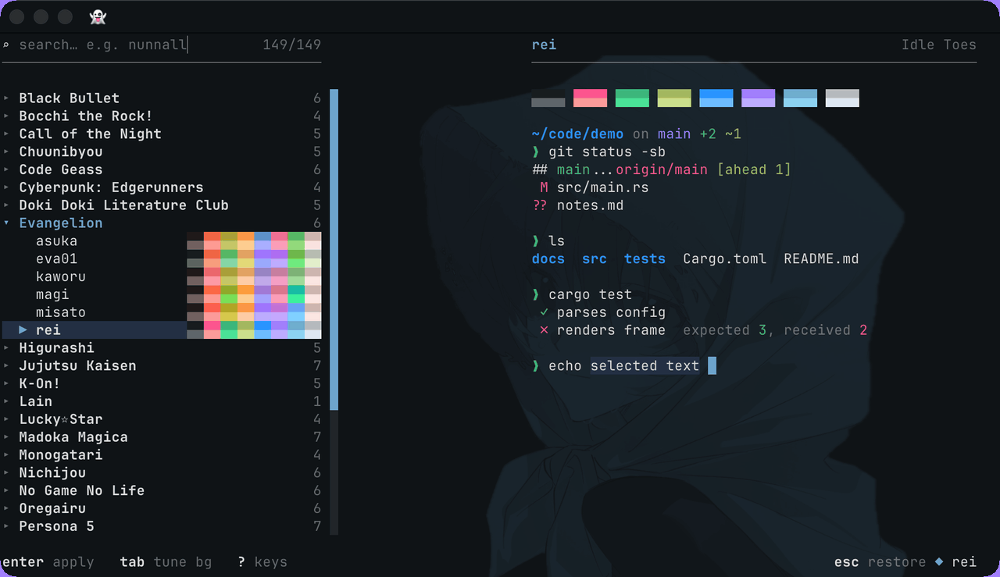

<h1 align="center">
  <picture>
    <source media="(prefers-color-scheme: light)" srcset="https://index.ttheme.dev/readme/banner-light.png">
    
  </picture>
</h1>

<p align="center"><em>Your favorite anime and game characters' colors in your terminal, one tab at a time.</em></p>

<p align="center">
  
</p>

```sh
npx @kecan0406/ttheme@latest init
```

<p align="center">
  <a href="https://ttheme.dev/">Site</a> |
  <a href="https://ttheme.dev/docs">Docs</a> |
  <a href="https://ttheme.dev/browse">Browse</a>
</p>
